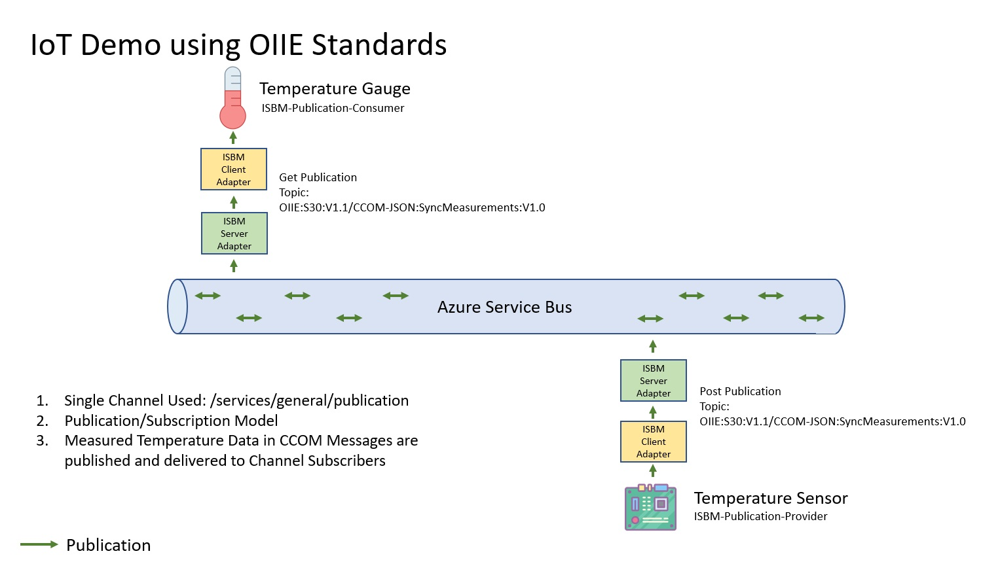
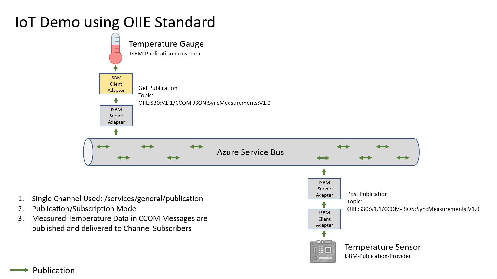
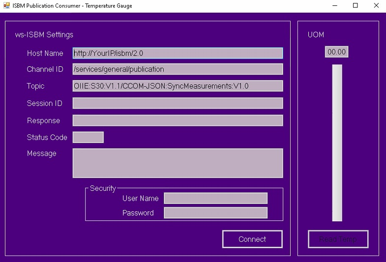

# ISBM-Publication-Consumer

This is one of the three-part series of proof-of-concept projects with the primary objective of constructing an interoperable IoT information cluster. The focus is on utilizing non-proprietary Open Industrial Interoperability Ecosystem (OIIE) open standards. Each project within this series explores key facets of building a cohesive and scalable IoT infrastructure, demonstrating the potential of OIIE standards in promoting interoperability in the interconnect world.


Figure 1. The summary of the IoT demo using OIIE standards. Included in this three-part series are ISBM-2.0-Server-Adapter and [ISBM-Publication-Provider](https://github.com/claire-wong/ISBM-Publication-Provider), hosted in their respective repositories.
A demo Window application that receives and consumes measured data using the ISBM 2.0 Adapter.

### Contents
  
   1. [Objectives](#objectives)
   2. [Project Information](#project-information)
   3. [Before Running the Program](#before-running-the-program)
   4. [Useful Links](#useful-links)
   5. [Quick Reference](#quick-reference)
  

### Objectives

Build a Windows application to receive published temperature data in CCOM format, embedded in the OAGIS BOD message via an ISBM 2.0 Server adapter from ISBM 2.0 adapter. Making it as an interoperable data consumer.


Figure 2. This project focuses on the temperature gauge as a sample ISBM Publication Consumer. The temperature data received via the ISBM Server Adapter will be displayed on the temperature gauge.

### Project Information

#### Version 0.4.0.0

A Windows program written in C#, targeting .NET Framework 4.7.2.

In this project, the NuGet package [RapidRedPanda.ISBM.ClientAdapter](https://www.nuget.org/packages/RapidRedPanda.ISBM.ClientAdapter/2.2.0) is utilized. This package is designed to handle all the details of ISBM implementations for communication with ISBM servers. The ISBM interface will be accessible through object classes that developers should find user-friendly and easy to use. This will cut down the learning curve of building ISBM-compliant devices or applications.

There is also a repository, [RapidRedPanda ISBM Client Adapter SDK Samples](https://github.com/claire-wong/RapidRedPanda.ISBM.ClientAdapter.SDK.Samples), for anyone wishing to learn more about using the ISBM Client Adapter.

The application opens with a temperature gauge and a configuration section. Enter the Host URL, Channel ID, Topic, and credentials if required, then select **Connect** to open a Consumer Publication subscription session. The Host returns the **Session ID** after a successful connection, and the application fills in that field automatically. Open the subscription before the Provider publishes the messages you want to receive.

Select **Read Temp** to start polling. When the Consumer retrieves a CCOM SyncMeasurements publication, it displays the temperature value and unit of measurement, then requests removal of the processed publication. Select **Stop** to stop polling, then select **Disconnect** to close the subscription session before exiting.

The companion Publication Provider waits about five seconds after each publication attempt. The Consumer uses a nominal two-second polling interval. Communication and processing time affect the actual intervals. The first reading depends on when an eligible publication arrives and the Consumer retrieves it.

#### Tools

- Windows and Visual Studio 2022 Community, the validated development environment
- The **.NET desktop development** workload and the **.NET Framework 4.7.2** targeting pack or developer pack

#### Dependencies

- .NET Framework 4.7.2
- RapidRedPanda.ISBM.ClientAdapter 2.2.0
- Newtonsoft.Json 13.0.1

Both NuGet packages are included in the repository. A complete checkout can build with the included packages.

#### Build and Run

1. Clone the repository or download and extract its source archive. The paths below apply to a checkout that includes the naming correction.
2. Open `ISBMTempGauge/ISBMTempGauge.sln` in Visual Studio 2022.
3. Select **Debug** or **Release**, then choose **Build > Build Solution**.
4. Run `ISBMTempGauge/bin/Debug/ISBMTempGauge.exe` for Debug or `ISBMTempGauge/bin/Release/ISBMTempGauge.exe` for Release. Keep the executable alongside `ISBMTempGauge.exe.config` and the dependency DLLs in the build output directory.

#### Windows Download Security

If you download the source code as a ZIP archive from GitHub, Windows may mark the downloaded files as originating from the Internet. This can cause Visual Studio build errors when processing resource files (`.resx`).

**Recommended approach before extracting the ZIP file**

1. Right-click the downloaded ZIP file.
2. Select **Properties**.
3. Select **Unblock**, if available.
4. Click **Apply**, then **OK**.
5. Extract the ZIP file and open the solution in Visual Studio.

**If the files have already been extracted**

Open PowerShell in the extracted repository directory and execute the following command.

```powershell
Get-ChildItem -Path . -Recurse -File | Unblock-File
```

Only unblock files obtained from a trusted source.

This step is generally unnecessary when the repository is obtained using `git clone`.

### Before Running the Program




Figure 3. Temperature Gauge

1. Enter the full ISBM 2.0 base URL in **Host Name**, including the scheme and `/isbm/2.0`, for example `https://your-host.example/isbm/2.0`. A hostname or domain alone is insufficient. Plain HTTP is suitable only for an explicitly unsecured local demo where the Host permits it.
2. Enter the **Channel ID** of an existing ISBM Publication channel and the **Topic** the Provider publishes. Use the same channel and case-sensitive topic in both applications. The demo values below also appear in the companion Provider's `ISBMTempSensor/Configs-Example.json`.

   - **Channel ID** `/services/general/publication`
   - **Topic** `OIIE:S30:V1.1/CCOM-JSON:SyncMeasurements:V1.0`

3. Leave **User Name** and **Password** blank for an unsecured channel. For a secured channel, enter authorized channel credentials and use trusted HTTPS with HTTP Basic authentication.

### Useful Links

#### Standard Organizations
   1. [OpenO&M](https://openoandm.org/)
   2. [MIMOSA](https://www.mimosa.org/)
   3. [International Society of Automation](https://www.isa.org/)
   4. [OAGi](https://oagi.org/)

#### Development Tools
   1. [Visual Studio 2022](https://learn.microsoft.com/en-us/visualstudio/releases/2022/release-history)
   2. [RapidRedPanda.ISBM.ClientAdapter 2.2.0](https://www.nuget.org/packages/RapidRedPanda.ISBM.ClientAdapter/2.2.0)
   

### Quick Reference

   1. OIIE - [OpenO&M Open Industrial Interoperability Ecosystem](https://www.mimosa.org/open-industrial-interoperability-ecosystem-oiie/)
   2. ISBM - [OpenO&M ISBM 2.0 Specification for the ISA-95 Message Service Model](https://www.openoandm.org/files/standards/ISBM-2.0.pdf)
   3. CCOM - [MIMOSA Common Conceptual Object Model](https://www.mimosa.org/mimosa-ccom/)
   4. BOD - [OAGIS Business Object Document](https://www.oagidocs.org/docs/)
